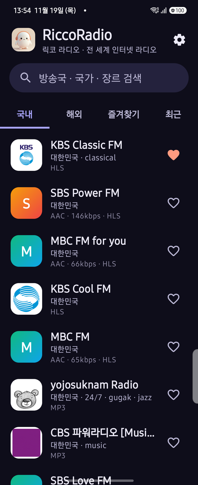
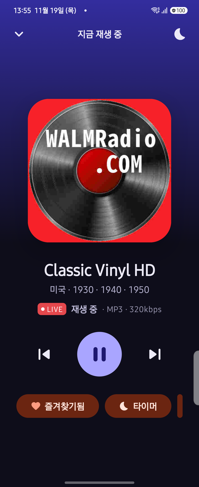
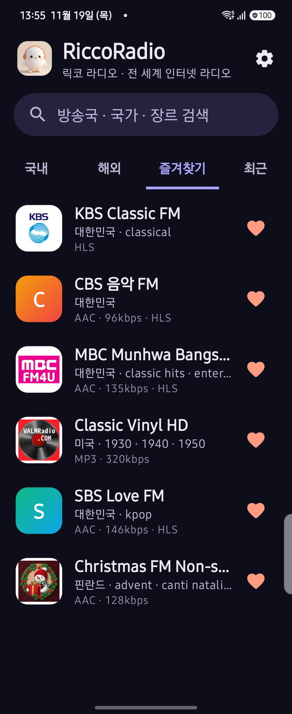
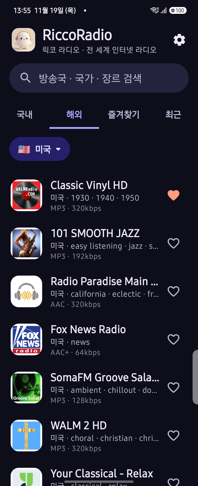
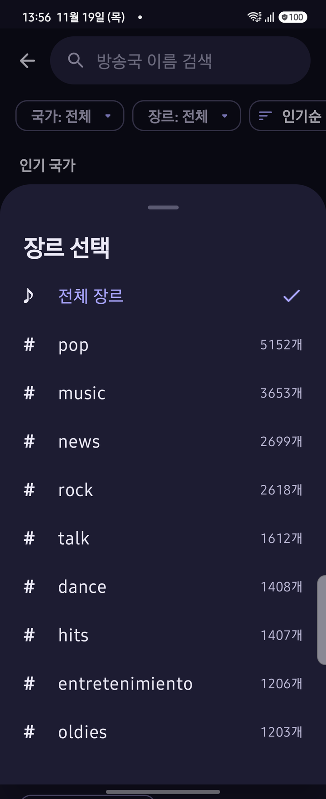
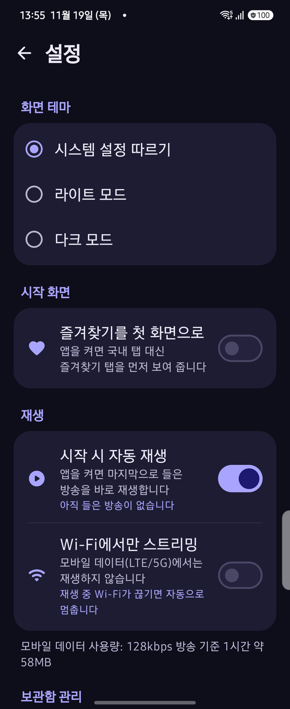

# RiccoRadio (릭코 라디오)

**전 세계 인터넷 라디오를 실시간으로 듣는 Android 앱**

국내 방송부터 해외 방송까지 이름·국가·장르로 찾아 바로 듣고, 즐겨찾기로 모아 두세요.
광고 없음 · 회원가입 없음 · 인앱결제 없음.

  
  
  

  
  
  

## 다운로드

👉 **[최신 버전 APK 받기 (Releases)](https://github.com/pjh3152/RiccoRadio-app/releases/latest)**

`Assets` 항목의 `RiccoRadio-x.y.z.apk` 를 받아 설치하면 됩니다.

- 지원 기기: Android 8.0 (Oreo) 이상
- 처음 설치할 때 "출처를 알 수 없는 앱 설치"를 허용해야 할 수 있습니다.
- 새 버전이 나오면 같은 방법으로 받아 덮어 설치하면 즐겨찾기·설정이 그대로 유지됩니다.

☕ 앱이 마음에 드셨다면 [카카오페이로 커피 한 잔 응원하기](https://qr.kakaopay.com/FbUYe4tN3)

## 주요 기능

### 📻 방송 찾기
- **국내 / 해외 / 즐겨찾기 / 최근** 탭
- 해외 탭에서 국가를 고르면 그 나라 인기 방송 목록
- 방송국 이름, 국가, 장르로 검색, 인기순·추천순·이름순·음질순 정렬
- 방송국 로고, 국가, 장르, 음질(코덱·kbps) 표시

### ▶️ 재생
- 누르면 바로 재생, 이전/다음 방송 넘기기
- 화면을 꺼도, 다른 앱을 써도 계속 재생 (백그라운드 재생)
- 알림창·잠금화면·블루투스 이어폰·차량 오디오에서 재생/정지/이전/다음 조작
- 전화가 오면 잠시 멈췄다가 끝나면 다시 재생, 이어폰을 뽑으면 자동 일시정지
- 방송이 곡 정보를 보내면 "지금 나오는 곡" 표시
- 연결이 끊기면 자동으로 다시 연결
- 취침 타이머 (15분 · 30분 · 60분 · 직접 설정)

### 🚗 안드로이드 오토
- 차 화면에서 즐겨찾기 · 최근 · 국내 · 해외 방송을 골라 들을 수 있습니다.
- 스토어가 아닌 APK 로 설치한 앱이므로, 안드로이드 오토 앱의 **개발자 설정**에서 "알 수 없는 출처"를 허용해야 차 화면에 나타납니다.

### ⚙️ 설정
- 시작 시 자동 재생 (마지막으로 들은 방송)
- Wi-Fi 에서만 스트리밍 (모바일 데이터 절약)
- 즐겨찾기를 첫 화면으로
- 라이트 / 다크 / 시스템 테마

## 권한 안내

| 권한 | 쓰는 곳 |
|---|---|
| 인터넷, 네트워크 상태 | 방송 목록 조회와 방송 재생, Wi-Fi 전용 재생 판단 |
| 포그라운드 서비스(미디어 재생) | 화면이 꺼져도 재생을 이어가기 |
| 절전 모드 해제 방지(WAKE_LOCK) | 재생 중 끊김 방지 |

개인정보를 수집하거나 외부로 보내지 않습니다. 자세한 내용은 [개인정보처리방침](https://pjh3152.github.io/RiccoRadio-app/privacy.html)을 확인하세요.

## 방송 정보 출처

방송국 목록과 주소는 누구나 참여하는 공개 디렉터리 [Radio Browser](https://www.radio-browser.info/) 에서 받아옵니다.
각 방송의 내용과 로고에 대한 권리는 해당 방송사에 있으며, 이 앱은 방송사가 공개한 인터넷 스트림을 재생만 합니다.
방송이 재생되지 않거나 정보가 틀린 경우 방송사 사정으로 주소가 바뀐 것일 수 있습니다.

## 버전 기록

<!-- 버전 기록 규칙: 새 버전은 이 아래 맨 위에 추가한다. 최근 3개만 펼쳐 두고, 4번째부터는 

이전 버전 보기 (N개)
 ... 
 안으로 옮긴다 (N = 접힌 개수). -->

### v1.0.2 (2026-11-20)

- 설정에 **☕ 개발자 응원하기**(카카오페이) 추가
- 앱을 어느 정도 쓴 뒤 가끔(2개월 간격, 최대 6번) 응원 안내가 뜹니다. ‘응원하기’를 누르면 다시 뜨지 않습니다

### v1.0.1 (2026-11-19)
- 진단 로그 기록을 기본으로 꺼 둠 (필요하면 설정 → 진단 로그 기록에서 켤 수 있음)

### v1.0.0 (2026-11-19)
- 첫 공개 버전

## 개인정보처리방침

[개인정보처리방침 보기](https://pjh3152.github.io/RiccoRadio-app/privacy.html)

## 문의 / 버그 제보

[Issues](https://github.com/pjh3152/RiccoRadio-app/issues) 에 남겨 주세요.
